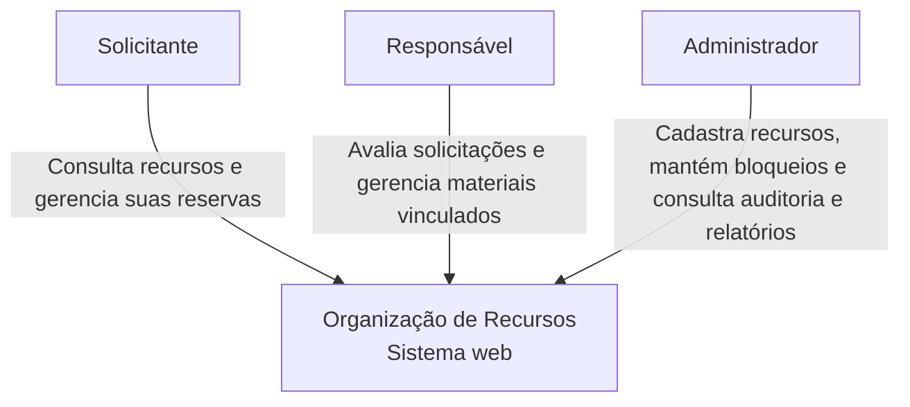
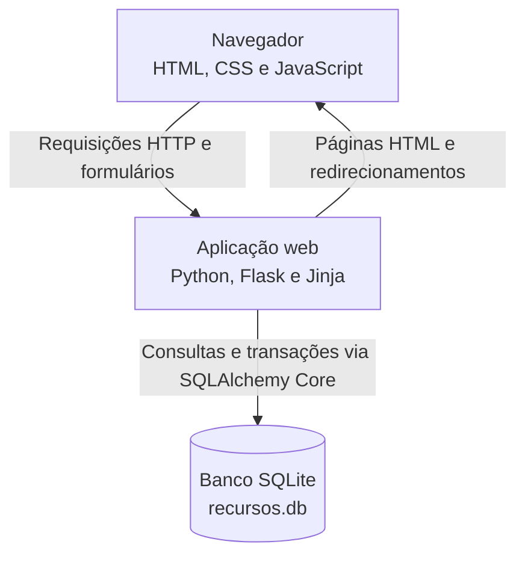
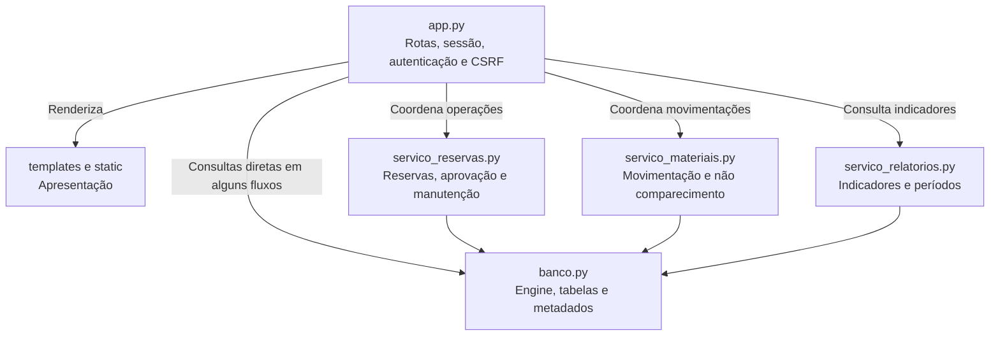
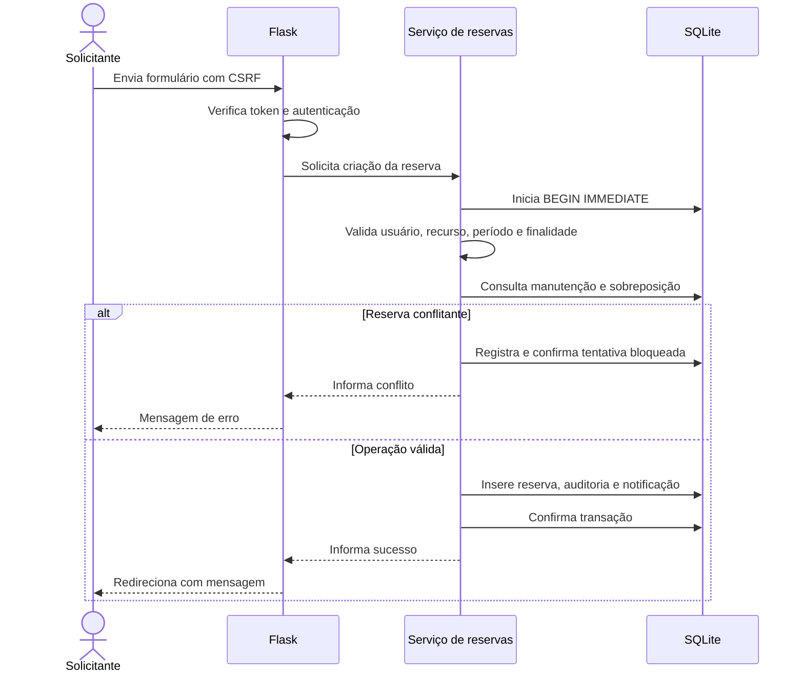
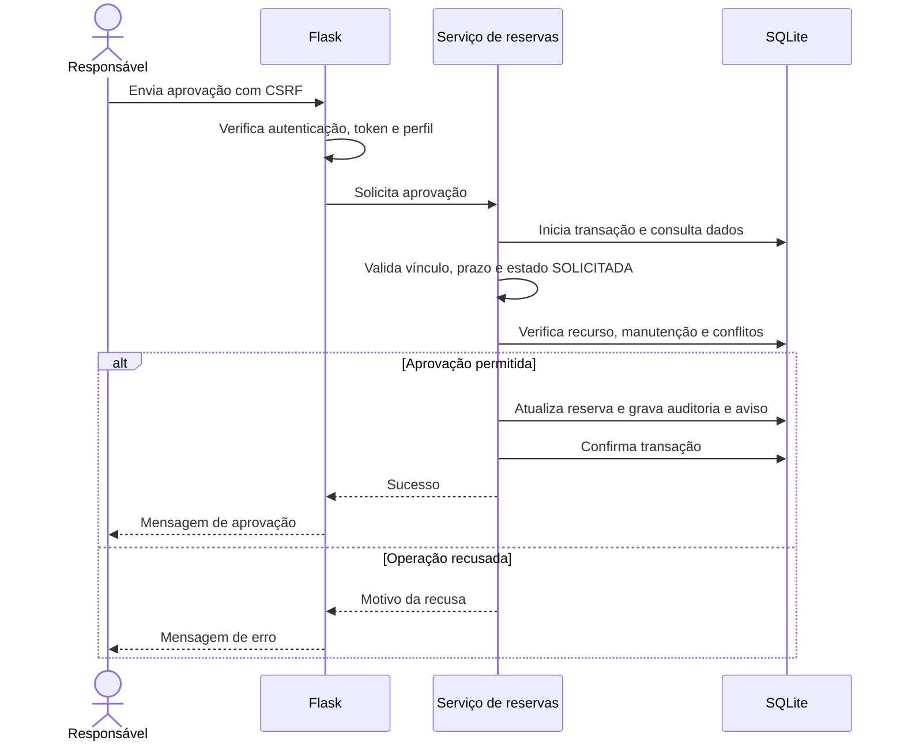
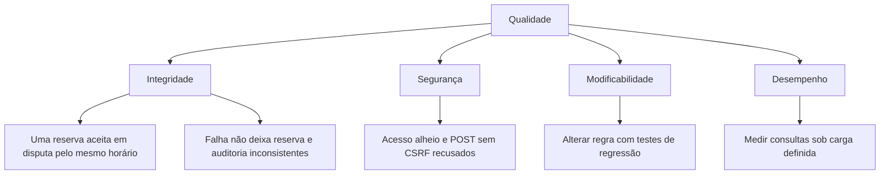

# Arquitetura — Organização de Recursos

**Data:** 02/11/2026  
**Integrantes:** Arthur Mendes, Robert Oliveira, Nicolas Ferreira.

## 1. Objetivo e escopo

O sistema organiza reservas de salas, professores e materiais, evitando sobreposições e controlando aprovação, manutenção, movimentação de materiais e histórico.

Esta documentação descreve a implementação acadêmica atual e suas limitações. Melhorias propostas são identificadas separadamente.

## 2. Estilo arquitetural

A aplicação é um monólito modular em Python, com interface HTML renderizada no servidor.

| Parte | Tecnologia | Responsabilidade |
| --- | --- | --- |
| Interface | HTML, CSS, JavaScript e Jinja | Formulários, listagens, mensagens e confirmações |
| Aplicação web | Flask, em app.py | Rotas, sessão, autenticação, CSRF e coordenação das operações |
| Serviços | Módulos Python | Regras de reservas, materiais e relatórios |
| Persistência | SQLAlchemy Core | Consultas, definições das tabelas e acesso transacional |
| Banco | SQLite | Armazenamento em recursos.db |
| Verificação | unittest, coverage.py e Playwright | Testes de regras, integração, rotas e navegador |
| Qualidade | GitHub Actions, Sonar e JMeter | CI, análise estática e ensaios de desempenho |

A separação é parcial: app.py ainda contém consultas e regras de alguns fluxos, além das responsabilidades HTTP.

## 3. C4 — Contexto

Os atores utilizam o mesmo sistema com permissões diferentes.

As notificações são avisos internos. Não existe integração atual com e-mail, SMS ou serviço externo de mensagens.

GitHub Actions e Sonar são ferramentas do processo de desenvolvimento e não participam das operações de reserva em execução.

## 4. C4 — Contêineres

Neste modelo, contêiner significa uma unidade de execução ou armazenamento. Não significa necessariamente um contêiner Docker.

No ambiente local utilizado nos ensaios, a aplicação foi acessada em 127.0.0.1:5003.

A configuração de produção com HTTPS e servidor WSGI próprio ainda não está demonstrada.

## 5. C4 — Componentes da aplicação

Os componentes são módulos do mesmo processo Python, sem comunicação por rede entre eles.

### Responsabilidades

| Componente | Responsabilidades |
| --- | --- |
| app.py | Receber requisições, verificar sessão e CSRF, aplicar permissões nas rotas e montar respostas |
| servico_reservas.py | Validar e executar criação, alteração, cancelamento, aprovação e operações relacionadas à manutenção |
| servico_materiais.py | Validar retirada, devolução e não comparecimento |
| servico_relatorios.py | Calcular contagens, horas previstas e conflitos evitados |
| banco.py | Definir tabelas, engine e criação da estrutura |
| templates | Apresentar formulários, dados e mensagens com Jinja |
| static | Estilos e recursos usados pelo navegador |
| Scripts administrativos | Preparar dados ou atualizar estruturas, fora do fluxo normal das requisições |

## 6. Dados principais

| Entidade | Finalidade |
| --- | --- |
| Usuários | Login, hash da senha, perfil e situação ativa |
| Recursos | Tipo, dados de pesquisa, restrição, situação e responsável |
| Reservas | Solicitante, recurso, período, finalidade e situação |
| Auditoria de reservas | Autor, operação, horário e dados da mudança |
| Manutenção | Recurso, período, motivo e autor |
| Notificações | Avisos internos destinados ao usuário |
| Conflitos de reservas | Tentativas bloqueadas por sobreposição |

As relações de negócio são verificadas pelos serviços e pelas restrições presentes na estrutura do banco.

A existência de referências nas tabelas não dispensa conferir a configuração de integridade referencial do SQLite nas conexões utilizadas.

## 7. Sequência — Criação de reserva

O estado inicial depende do recurso: recursos restritos e professores aguardam aprovação; recursos comuns podem ser aprovados automaticamente.

Erros de validação não representam operações bem-sucedidas e não devem gerar avisos de sucesso.

## 8. Sequência — Aprovação

Quando a recusa decorre de outra reserva sobreposta, a tentativa é registrada como conflito evitado.

## 9. Segurança e permissões

| Controle | Implementação ou limite |
| --- | --- |
| Senhas | Verificação por hash, sem armazenamento da senha em texto puro |
| Autenticação | Sessão do Flask e consulta de usuário ativo |
| Autorização | Perfil, propriedade da reserva e vínculo com o recurso |
| CSRF | Token nos formulários POST e validação no servidor |
| Renovação de token | Novo token após autenticação |
| Consultas | SQLAlchemy Core com parâmetros |
| Saída HTML | Escape do Jinja; teste específico em duas páginas |
| Cookies | HttpOnly e SameSite=Lax configurados |
| HTTPS e cookie Secure | Configuração de implantação ainda pendente |
| Dependências | Lock com hashes e auditoria registrada |

Esses controles reduzem riscos nos cenários verificados. Não representam uma revisão completa de segurança.

Evidências e limitações adicionais estão em SEGURANCA.md.

## 10. Integridade e concorrência

O fluxo de reserva utiliza BEGIN IMMEDIATE para serializar gravações no SQLite.

A verificação de sobreposição ocorre dentro da transação que controla a operação, reduzindo o risco de duas solicitações aceitarem o mesmo horário.

Reservas em SOLICITADA, APROVADA e EM_USO participam do bloqueio por sobreposição. Horários consecutivos são permitidos.

Reserva, auditoria e notificação são confirmadas em conjunto nos fluxos correspondentes. Uma falha nessas gravações provoca rollback.

O registro de conflito bloqueado possui tratamento específico: a tentativa é confirmada sem alterar a reserva, antes da apresentação do erro.

A concorrência foi testada no serviço. A equivalência sob acesso HTTP concorrente e outros ambientes ainda precisa ser verificada.

## 11. Árvore de utilidade

As prioridades abaixo são propostas para orientar a avaliação arquitetural. Não representam aprovação formal do grupo.

| Cenário | Importância | Dificuldade | Evidência ou critério |
| --- | --- | --- | --- |
| Duas solicitações disputam recurso e período | Alta | Alta | Teste no serviço exige uma aceita e uma bloqueada |
| Falha durante auditoria | Alta | Média | Testes verificam rollback da operação |
| Usuário tenta alterar reserva alheia | Alta | Média | Rotas recusam acesso e preservam os dados |
| Token CSRF ausente, inválido ou de outra sessão | Alta | Média | Testes verificam recusa |
| Mudança em regra de reserva | Alta | Média | Suíte de regressão, cobertura e CI |
| Consulta da página de login sob carga | Média | Média | Ensaio exploratório; critério de aceitação ainda não definido |
| Operação com muitas gravações concorrentes | Alta | Alta | Limite do SQLite deve ser avaliado em novos ensaios |

## 12. Decisões arquiteturais

Estas decisões descrevem escolhas observadas na implementação. O registro foi elaborado após sua adoção e ainda requer revisão por outro integrante.

### ADR-01 — Monólito modular com Flask

**Estado:** adotado na implementação.

**Contexto:** projeto acadêmico com equipe pequena e necessidade de entregar fluxos completos.

**Decisão:** manter uma aplicação Flask e separar parte das regras em módulos de serviço.

**Alternativas consideradas neste registro:** concentrar tudo nas rotas ou separar em serviços independentes.

**Consequências:** instalação e execução simples; módulos podem ser testados separadamente. app.py ainda concentra responsabilidades e pode exigir divisão futura.

### ADR-02 — SQLite com SQLAlchemy Core

**Estado:** adotado na implementação.

**Contexto:** necessidade de persistência local e testes com banco temporário.

**Decisão:** utilizar SQLite e consultas com SQLAlchemy Core.

**Alternativas consideradas neste registro:** banco servidor, como PostgreSQL, ou armazenamento sem banco relacional.

**Consequências:** menor infraestrutura inicial e testes locais simples. Gravações concorrentes têm limitações, e a migração para outro banco exigirá revisão de consultas, transações e scripts.

### ADR-03 — Serializar gravações de reservas

**Estado:** adotado na implementação.

**Contexto:** duas solicitações podem consultar o mesmo horário antes de gravar.

**Decisão:** usar BEGIN IMMEDIATE no fluxo transacional e consultar conflitos dentro da operação.

**Alternativa considerada neste registro:** consultar disponibilidade antes da transação.

**Consequências:** protege a decisão de reserva no ambiente SQLite testado. Pode aumentar espera entre escritores e não constitui uma solução portável sem revisão.

### ADR-04 — Auditoria na mesma transação

**Estado:** adotado na implementação.

**Contexto:** uma mudança de estado sem evento correspondente prejudica a rastreabilidade.

**Decisão:** confirmar operação e auditoria em conjunto; incluir notificações nos fluxos correspondentes.

**Alternativa considerada neste registro:** registrar auditoria depois da confirmação da reserva.

**Consequências:** consistência entre os registros. Falha na auditoria impede a operação, aumentando a importância da confiabilidade dessa gravação.

### ADR-05 — Avisos internos persistidos

**Estado:** adotado na implementação.

**Contexto:** necessidade de informar o solicitante sem integração externa.

**Decisão:** armazenar notificações e apresentá-las após login.

**Alternativas consideradas neste registro:** e-mail ou serviço externo.

**Consequências:** funcionamento demonstrável sem credenciais externas. O usuário precisa acessar o sistema para consultar os avisos; não há entrega externa ou atualização em tempo real.

### ADR-06 — Verificações automáticas na CI

**Estado:** adotado na implementação.

**Contexto:** mudanças podem introduzir regressões ou reduzir cobertura.

**Decisão:** executar testes, verificar metas de cobertura, publicar relatórios, executar navegador e integrar o Quality Gate do Sonar.

**Alternativa considerada neste registro:** verificação somente manual antes da entrega.

**Consequências:** resultados reproduzíveis por execução e feedback nas mudanças. A aprovação depende do escopo dos testes e não substitui revisão por pares.

## 13. Riscos e trade-offs

| Risco ou escolha | Benefício | Custo ou limitação | Tratamento |
| --- | --- | --- | --- |
| SQLite local | Configuração simples | Escritas serializadas e dependência de arquivo | Testes de concorrência; avaliar banco servidor se necessário |
| Regras distribuídas entre rotas e serviços | Evolução incremental | Maior acoplamento em app.py | Extrair regras gradualmente com regressão |
| Auditoria transacional | Histórico consistente | Falha do registro impede operação | Testes de rollback |
| Avisos internos | Sem dependência de serviço externo | Consulta depende de acesso ao sistema | Documentar limite |
| Horário local do servidor | Implementação simples | Ambiguidade em implantação com fusos diferentes | Definir política de tempo antes de implantação |
| Criação de estrutura durante importação | Inicialização conveniente | Efeito colateral e cuidado adicional nos testes | Separar inicialização em evolução futura |
| Scripts de migração manuais | Adequados à evolução inicial | Risco operacional e cobertura desigual | Backup, revisão e testes específicos |
| Cliente e servidor de carga na mesma máquina | Execução acessível | Resultados influenciados pelo ambiente compartilhado | Preservar evidência e ampliar ensaios |
| Servidor local de desenvolvimento | Demonstração rápida | Implantação de produção não validada | Planejar servidor WSGI e HTTPS |
| Ausência de teste de restauração completo | Menor esforço inicial | Recuperação de desastre não demonstrada | Planejar restauração de backup |

## 14. Estratégia de verificação

| Tipo | Ferramenta ou abordagem | Limite |
| --- | --- | --- |
| Regras e integração | unittest com SQLite temporário | Muitos testes não são unitários totalmente isolados |
| Rotas | Cliente Flask | Não executa JavaScript |
| Navegador | Playwright e Chromium | Um fluxo principal automatizado |
| Cobertura | coverage.py | Escopo Python definido; não mede templates |
| Análise estática | SonarQube Cloud | Resultado depende do commit e da configuração |
| Desempenho | JMeter | GET /login em ambiente local |
| Dependências | pip-audit | Vulnerabilidades conhecidas da base consultada |
| Revisão humana | Revisão por integrante | Ainda pendente de registro |

Os resultados e versões estão documentados em RTM.md, SEGURANCA.md e performance/README.md.

## 15. Pendências de revisão

- Revisar os diagramas com outro integrante.
- Conferir requisitos críticos e responsabilidades de cada módulo.
- Definir critérios de desempenho antes dos próximos ensaios.
- Ampliar concorrência por HTTP.
- Verificar banco em container ou alternativa aceita.
- Planejar implantação, HTTPS, segredo de sessão e política de horários.
- Testar restauração de backup.
- Revisar scripts administrativos e migrações ainda sem testes.
- Registrar autor, data e observações da revisão por pares.

## 16. Referências do projeto

- [README](README.md)
- [Rastreabilidade](RTM.md)
- [Segurança](SEGURANCA.md)
- [Desempenho](performance/README.md)
- [Repositório](https://github.com/Arthurmrsilva/organizacao-recursos)